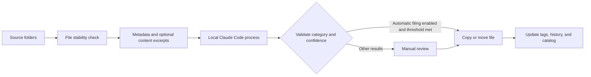

<div align="center">
  
  <h1>FileAtlas</h1>
  <p><a href="README.md">简体中文</a> · <a href="README.en.md">English</a></p>
  <p>A place for every file.</p>
  <p>Smart file organization for Windows · Claude Code tagging · Hierarchical categories · Live catalog</p>
  <p>
    
    
    
    
  </p>
</div>

FileAtlas is a desktop file organizer for Windows 11. Configure your categories, destination folders, and source folders, and it will call your local Claude Code installation when files change, suggest categories and tags, and copy or move files according to your settings.

The interface uses a system Acrylic backdrop, a light sidebar, rounded panels, and short transitions. Directory scans, AI classification, file operations, and content previews run in the background.


The application interface is currently in Simplified Chinese. This README provides English instructions, with the actual Chinese menu labels included below.

## Features

**New in 0.2.0: CAE workspace and project templates.** Preview the directory layout, create project stages and a baseline case, configure destinations, require review for ambiguous project IDs, and preserve native solver files and detected case companions. See the [CAE workflow](docs/CAE_WORKFLOW.md) and [quick start](docs/QUICK_START.md) (Chinese).

| Feature | Description |
| --- | --- |
| Hierarchical categories | Create parent and child categories, each with its own destination and classification guidance |
| Existing folder import | Generate categories from an existing folder structure and index its files |
| Automatic tagging | Claude Code generates tags from filenames, paths, and optional content excerpts |
| Folder monitoring | Recursively monitor multiple source folders and queue files after they stabilize |
| Automatic filing | File high-confidence results automatically and send other results to review |
| File catalog | Update a logical category tree and export the complete catalog as Markdown |
| Operation history | Record source paths, destinations, and operation status, with verified undo |
| Search | Find files by filename, path, category, or tags |

## Quick start

### Windows portable application

Download `FileAtlas-0.2.1-win64.zip`, extract it, and run `FileAtlas.exe`. Keep the `_internal` folder alongside the executable. [GitHub Releases](https://github.com/AHuaWinliver/FileAtlas/releases)

1. Open **Categories & Catalog** (`分类与目录`). Create categories and set their destinations and classification guidance, or import an existing folder structure.
2. Open **Automation Settings** (`自动化设置`). Select your source folders, check the `claude.exe` path, and save.
3. Click **Scan Source Folders** (`扫描源文件夹`), then check the suggestions in **Review** (`待审核`).
4. Once the results meet your needs, choose copy or move mode and click **Save and Start Automatic Filing** (`保存并启动自动整理`).

To file by type, add `扩展名规则：.pdf .docx` on its own line in the category guidance. A single matching category receives the file and an extension tag. With zero or multiple matches, FileAtlas uses model classification.

The initial defaults use copy mode and require manual review. Closing the window can leave the application running in the system tray; right-click its tray icon to exit. Monitoring must be started again after restarting the application.

### Run from source

You need Windows 11 x64, Python 3.12, and an installed and configured copy of [Claude Code](https://code.claude.com/docs/en/overview). Tests and the empty application interface do not require a model account. Actual AI classification requires a working Claude Code service configuration.

```powershell
python -m venv .venv
.\.venv\Scripts\python.exe -m pip install -r requirements.txt
.\.venv\Scripts\python.exe app.py
```

## Claude Code and data flow



The Claude Code process runs locally. Where the model runs depends on its configured service. With a cloud service, filenames, paths, and any enabled content excerpts are sent to that service. With a compatible local service, a local model handles the request. Content extraction can be disabled.

FileAtlas inherits Claude Code's authentication and model configuration. You can override the model and service URL within FileAtlas without changing global Claude settings. Classification calls disable tools, MCP, slash commands, and hooks. The AI returns a category ID and tags; FileAtlas performs the file operations.

Tags, settings, and logs are stored in `%LOCALAPPDATA%\FileAtlas`. Tags are kept in the local index rather than being embedded in filenames or original file contents.

## File protection and current limits

- Files with conflicting names are both retained. Copies are checked using SHA-256; move mode removes the source after verification.
- Undo verifies the destination first. Modified destination files, occupied original paths, and similar conditions block destructive operations.
- Content excerpts are supported for text, PDF, and DOCX files. Images, scanned PDFs, legacy Office files, audio, video, and archives currently use filenames and metadata; OCR is not available.
- Files must remain stable for at least three seconds. Files larger than 30 MB use metadata only.
- The library displays up to 1,000 recent matching records per search, and the tree displays up to 200 files per category. Markdown exports include all indexed and filed records.
- Cross-filesystem moves and database updates cannot form a single atomic transaction. Interrupted operations are marked `recovery` and require checking the source and destination.
- This is an early release. Large-scale endurance, power-failure injection, and long-running network-drive tests have not been completed.

See the [User Guide](docs/USER_GUIDE.md) for additional details. The supporting documentation is currently in Chinese.

## Development and testing

```powershell
# No Claude installation or model requests required
.\.venv\Scripts\python.exe -m unittest discover -s tests -v
.\.venv\Scripts\python.exe scripts/validate_worker.py
.\.venv\Scripts\python.exe scripts/validate_ui.py

# Optional: test your configured model using a dedicated sample file
.\.venv\Scripts\python.exe scripts/validate_live.py

# Build the Windows executable and portable ZIP
.\.venv\Scripts\python.exe -m pip install -r requirements-dev.txt
.\.venv\Scripts\python.exe scripts/build.py
```

Use `app.py --data-dir <path>` to select an isolated application data directory. Add `--smoke` to start the application, capture a screenshot, and exit.

## Repository structure

```text
FileAtlas/
├── .github/            # Windows CI, build workflow, and collaboration templates
├── assets/             # Icons and interface preview
├── docs/               # User guide, research, validation, and release documentation
├── scripts/            # Build and integration validation scripts
├── tests/              # Core file operation tests
├── app.py              # Desktop interface
├── core.py             # Classification, indexing, filing, and undo
├── worker.py           # Background monitoring and task processing
└── FileAtlas.spec      # PyInstaller build configuration
```

## Documentation and contributions

The following supporting documents are currently in Chinese:

- [User Guide](docs/USER_GUIDE.md) · [Product Research](docs/RESEARCH.md) · [Validation Record](docs/VALIDATION.md)
- [GitHub Upload Guide](docs/GITHUB_UPLOAD.md) · [Build and Release Guide](docs/RELEASING.md)
- [Contributing](CONTRIBUTING.md) · [Security and Privacy](SECURITY.md) · [Changelog](CHANGELOG.md)

Use Issues to report bugs or suggest features, and Pull Requests to contribute improvements. Remove private paths, document contents, and service credentials before sharing logs.

## License

FileAtlas's own source code is available under the [MIT License](LICENSE). Third-party components retain their respective licenses; see [THIRD_PARTY_NOTICES.md](THIRD_PARTY_NOTICES.md).
