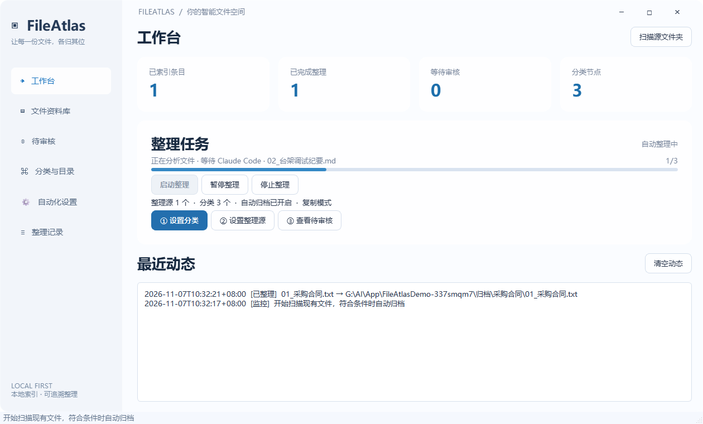
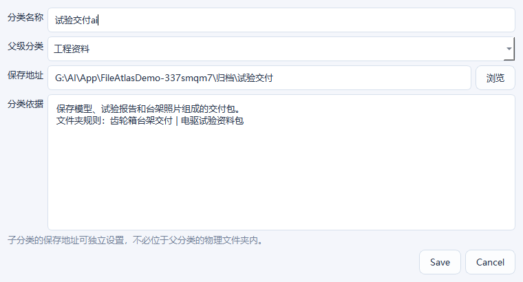
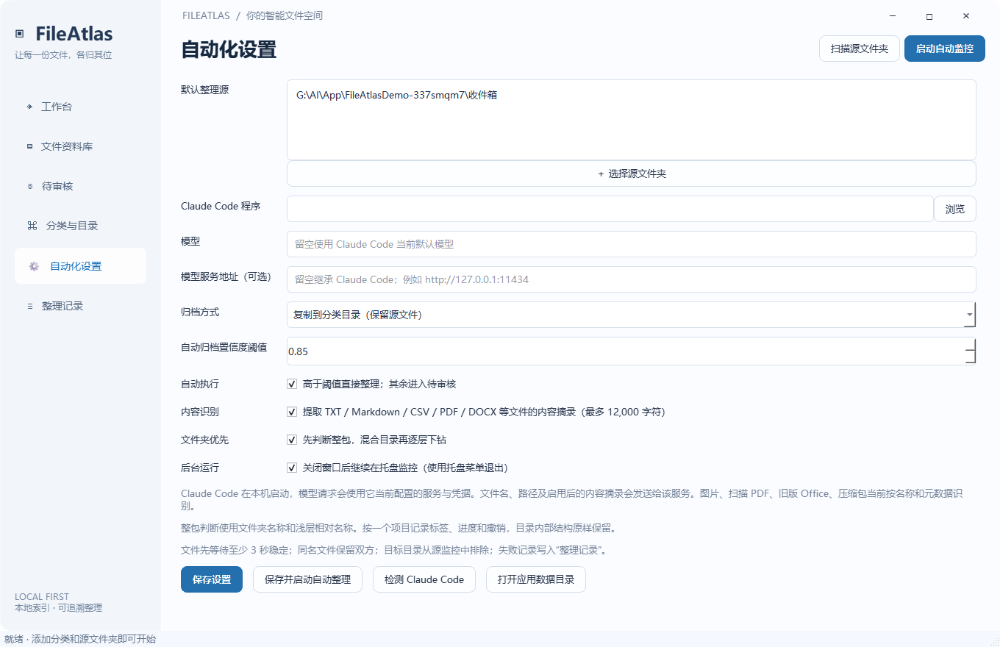
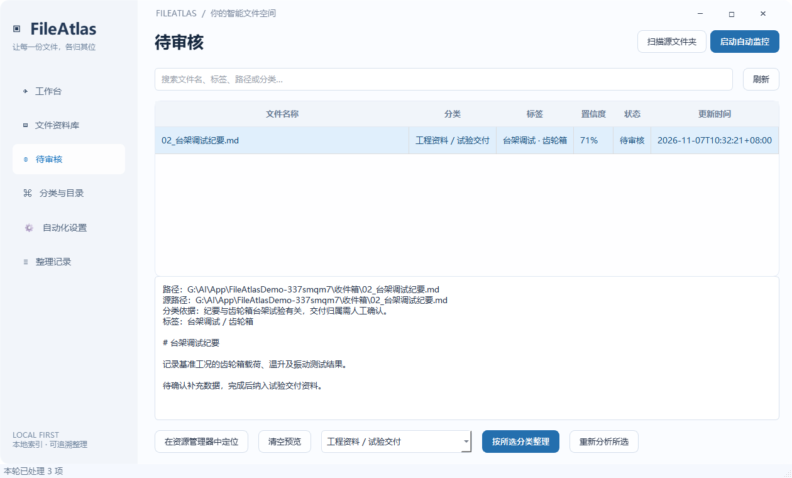
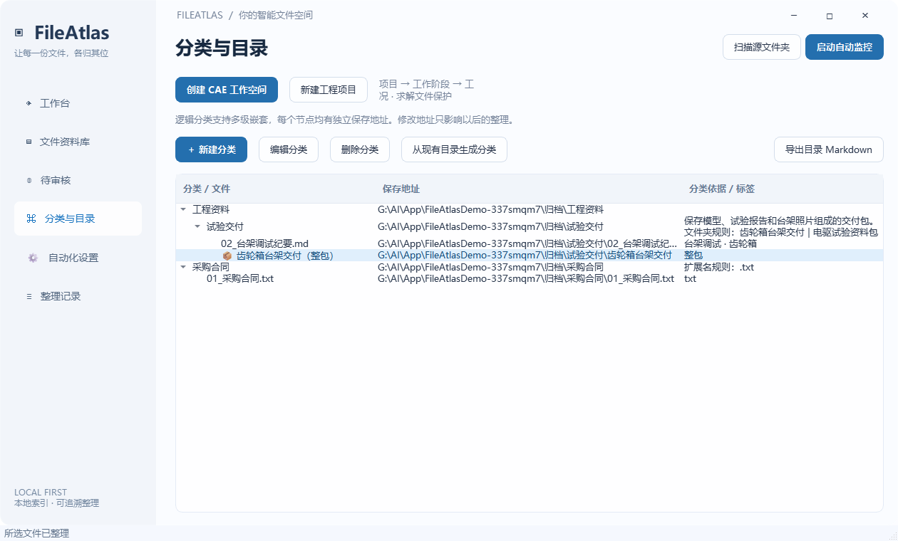
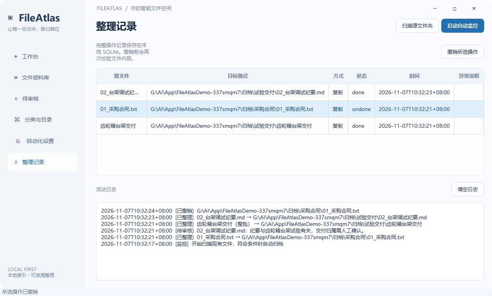
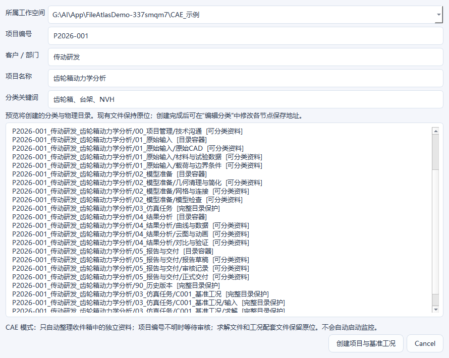
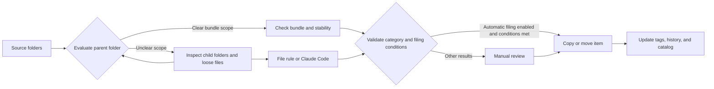

<div align="center">
  
  <h1>FileAtlas</h1>
  <p><a href="README.md">简体中文</a> · <a href="README.en.md">English</a></p>
  <p>A place for every file.</p>
  <p>Smart file organization for Windows · Claude Code tagging · Hierarchical categories · Live catalog</p>
  <p>
    
    
    
    
  </p>
</div>

FileAtlas is a desktop file organizer for Windows 11. Give each category a destination, then select the source folders that receive new material. FileAtlas checks whether folders belong together, suggests categories and tags for loose files, and copies, moves, or queues items for review according to your settings.

The interface uses a system Acrylic backdrop, a light sidebar, rounded panels, and short transitions. Directory scans, AI classification, file operations, and content previews run in the background.



The **dashboard** shows the current item, recent activity, and progress. The `1/3` counter in the screenshot shows that one of three items has been processed. A loose file and a complete delivery folder each count as one item.

The screenshots use demo data and a simulated model response for the commissioning notes. The app interface is in Simplified Chinese, and the English instructions include its exact control labels. [Changelog](CHANGELOG.md)

## Quick start

### Windows portable application

Download the v0.3.1 Windows installer or portable package. For the portable package, extract it, run `FileAtlas.exe`, and keep the `_internal` folder alongside it. Source and build instructions follow below. [Windows downloads and release notes](https://github.com/AHuaWinliver/FileAtlas/releases/tag/v0.3.1) · [Source tags](https://github.com/AHuaWinliver/FileAtlas/tags)

## Illustrated walkthrough

### 1. Set up categories and a folder rule



In **Categories & Catalog** (`分类与目录`), create Engineering Records → Test Deliveries (`工程资料 → 试验交付`). Give Test Deliveries its own destination, such as `D:\Archive\Test Deliveries`. Use **Generate Categories from Existing Folders** (`从现有目录生成分类`) to start from a folder structure you already use.

Add `文件夹规则：齿轮箱台架交付 | 电驱试验资料包` to the category guidance. Each alias matches a full folder name. In the example below, the gearbox delivery folder keeps its original structure. The purchase contract can match a separate `扩展名规则：.txt` rule, and the commissioning notes can be sent to review.

```text
收件箱/                              Inbox
├── 齿轮箱台架交付/                  Gearbox test delivery
│   ├── 01_模型/装配.step             Assembly model
│   ├── 02_报告/试验结论.pdf           Test report
│   └── 03_图片/台架.png              Test rig photo
├── 01_采购合同.txt                  Purchase contract
└── 02_台架调试纪要.md               Commissioning notes
```

| Folder situation | Result |
| --- | --- |
| Full name matches a unique folder rule | File it as one unit. An explicit conflicting rule for a nested folder causes FileAtlas to descend |
| Folder name matches one eligible category | Consider it as a bundle. If the category has an extension rule, every file in the bundle must fit it |
| Descriptive folder name with no direct match | Claude Code evaluates the folder name, parent name, and a limited sample of shallow relative names. A clear, high-confidence match can keep the folder intact |
| Generic folder name, mixed contents, or insufficient evidence | Inspect child folders and classify the remaining loose files individually |
| Protected CAE case | Leave protected solver material and marked case directories in place |

Model-selected bundles enter Review in move mode.

### 2. Configure the source folders and start a scan



In **Automation Settings** (`自动化设置`), add your source folders and choose copy or move mode. Select your local `claude.exe` for model classification. Folder-first filing (`文件夹优先`) is enabled by default. For a first pass, the default copy and review settings let you inspect the classification results.

Click **Scan Source Folders** (`扫描源文件夹`) to scan once, or **Start Filing** (`启动整理`) to keep monitoring. **Save and Start Automatic Filing** (`保存并启动自动整理`) saves the settings, enables automatic filing, and starts monitoring. **Pause Filing** (`暂停整理`) and **Stop Filing** (`停止整理`) take effect after the current item finishes. Resume a paused pass with **Resume Filing** (`继续整理`). Starting again after a stop scans the sources afresh.

### 3. Review the category, tags, and explanation



In **Review** (`待审核`), select the commissioning notes to read the classification explanation, suggested tags, and a content excerpt. Choose Engineering Records / Test Deliveries in the dropdown, then click **File to Selected Category** (`按所选分类整理`). Use **Analyze Again** (`重新分析所选`) to get another suggestion.

### 4. Find the delivery in the catalog



The gearbox delivery appears in the tree as a single bundle (`整包`). Double-click it to open the archived folder, or use **Export Markdown Catalog** (`导出目录 Markdown`) to generate the catalog. In the **File Library** (`文件资料库`), search by name, path, category, or tag.

### 5. Inspect and undo an operation



In **Operation History** (`整理记录`), select an operation and click **Undo Selected Operation** (`撤销所选操作`). FileAtlas verifies the content and paths before proceeding. The status `undone` confirms completion. **Clear Log** (`清空日志`) and **Clear Activity** (`清空动态`) reset the two activity views together. Operation history stays available for inspection and undo.

## CAE project templates



In **Categories & Catalog** (`分类与目录`), create a CAE workspace and choose **New Engineering Project** (`新建工程项目`). Enter the project ID and name to preview its stages and the `C001` baseline case. The template marks folders eligible for filing and folders protected as a unit. Files with ambiguous project IDs go to Review. [CAE workflow](docs/CAE_WORKFLOW.md)

## Run from source

You need Windows 11 x64, Python 3.12, and an installed and configured copy of [Claude Code](https://code.claude.com/docs/en/overview). Tests and the empty application interface do not require a model account. Actual AI classification requires a working Claude Code service configuration.

```powershell
python -m venv .venv
.\.venv\Scripts\python.exe -m pip install -r requirements.txt
.\.venv\Scripts\python.exe app.py
```

## Claude Code and data flow



The Claude Code process runs locally. The configured service determines where the model runs. For folder decisions, the request includes the folder name and a limited sample of shallow relative names. File decisions use names, path information, and optional content excerpts. A cloud configuration sends that information to the selected service. A compatible local configuration processes it locally.

FileAtlas inherits Claude Code's authentication and model configuration. You can override the model and service URL within FileAtlas without changing global Claude settings. Classification calls disable tools, MCP, slash commands, and hooks. The AI returns a category ID and tags; FileAtlas performs the file operations.

Tags, settings, and logs are stored in `%LOCALAPPDATA%\FileAtlas`. Tags are kept in the local index rather than being embedded in filenames or original file contents.

## File protection and current limits

- Files with conflicting names are both retained. Copies are checked using SHA-256; move mode removes the source after verification.
- Bundle verification also covers relative paths, empty directories, and file contents. If an archived bundle has changed, undo preserves the archived copy and reports the reason.
- Undo verifies the destination first. Modified destination files, occupied original paths, and similar conditions block destructive operations.
- Content excerpts are supported for text, PDF, and DOCX files. Images, scanned PDFs, legacy Office files, audio, video, and archives currently use filenames and metadata; OCR is not available.
- Files must remain stable for at least three seconds. Files larger than 30 MB use metadata only.
- The library displays up to 1,000 recent matching records per search, and the tree displays up to 200 files per category. Markdown exports include all indexed and filed records.
- Cross-filesystem moves and database updates cannot form a single atomic transaction. Interrupted operations are marked `recovery` and require checking the source and destination.
- This is an early release. Large-scale endurance, power-failure injection, and long-running network-drive tests have not been completed.

See the [User Guide](docs/USER_GUIDE.md) for additional details. The supporting documentation is currently in Chinese.

## Development and testing

```powershell
# No Claude installation or model requests required
.\.venv\Scripts\python.exe -m unittest discover -s tests -v
.\.venv\Scripts\python.exe scripts/validate_worker.py
.\.venv\Scripts\python.exe scripts/validate_ui.py

# Optional: test your configured model using a dedicated sample file
.\.venv\Scripts\python.exe scripts/validate_live.py

# Build the Windows executable and portable ZIP
.\.venv\Scripts\python.exe -m pip install -r requirements-dev.txt
.\.venv\Scripts\python.exe scripts/build.py
```

Use `app.py --data-dir <path>` to select an isolated application data directory. Add `--smoke` to start the application, capture a screenshot, and exit.

## Repository structure

```text
FileAtlas/
├── .github/            # Windows CI, build workflow, and collaboration templates
├── assets/             # Icons and interface preview
├── docs/               # User guide, research, validation, and release documentation
├── scripts/            # Build and integration validation scripts
├── tests/              # Core file operation tests
├── app.py              # Desktop interface
├── bundles.py          # Folder snapshots, verified copies, and safe bundle undo
├── core.py             # Classification, indexing, filing, and undo
├── worker.py           # Background monitoring and task processing
└── FileAtlas.spec      # PyInstaller build configuration
```

## Documentation and contributions

The following supporting documents are currently in Chinese:

- [User Guide](docs/USER_GUIDE.md) · [Product Research](docs/RESEARCH.md) · [Validation Record](docs/VALIDATION.md)
- [GitHub Upload Guide](docs/GITHUB_UPLOAD.md) · [Build and Release Guide](docs/RELEASING.md)
- [Contributing](CONTRIBUTING.md) · [Security and Privacy](SECURITY.md) · [Changelog](CHANGELOG.md)

Use Issues to report bugs or suggest features, and Pull Requests to contribute improvements. Remove private paths, document contents, and service credentials before sharing logs.

## License

FileAtlas's own source code is available under the [MIT License](LICENSE). Third-party components retain their respective licenses; see [THIRD_PARTY_NOTICES.md](THIRD_PARTY_NOTICES.md).
