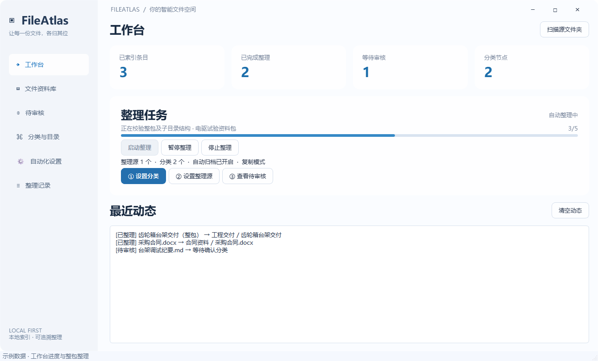
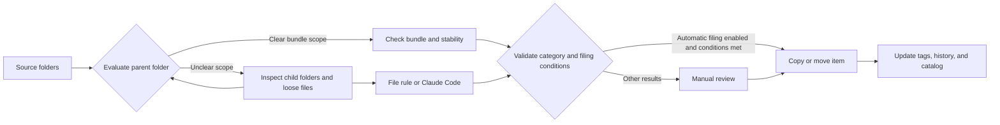

<div align="center">
  
  <h1>FileAtlas</h1>
  <p><a href="README.md">简体中文</a> · <a href="README.en.md">English</a></p>
  <p>A place for every file.</p>
  <p>Smart file organization for Windows · Claude Code tagging · Hierarchical categories · Live catalog</p>
  <p>
    
    
    
    
  </p>
</div>

FileAtlas is a desktop file organizer for Windows 11. Give each category a destination, then select the source folders that receive new material. FileAtlas checks whether folders belong together, suggests categories and tags for loose files, and copies, moves, or queues items for review according to your settings.

The interface uses a system Acrylic backdrop, a light sidebar, rounded panels, and short transitions. Directory scans, AI classification, file operations, and content previews run in the background.



The application interface is currently in Simplified Chinese. This README provides English instructions, with the actual Chinese menu labels included below.

## Features

**v0.3.0 adds folder-first filing.** An engineering delivery can be filed as one item with its models, drawings, reports, and empty directories intact. The dashboard can start, pause, resume, or stop filing and shows the progress of each pass. [Changelog](CHANGELOG.md)

| Feature | Description |
| --- | --- |
| Hierarchical categories | Create parent and child categories, each with its own destination and classification guidance |
| Existing folder import | Generate categories from an existing folder structure and index its files |
| Folder-first filing | Evaluate parent folders first and descend when their scope is unclear. An intact folder appears as one entry in the library and catalog |
| Automatic tagging | Direct rules can classify without a model call. Claude Code can use file metadata and optional excerpts |
| Dashboard controls | Start, pause, resume, stop, or run a one-time scan. See the current stage and processed/total count |
| Automatic filing | File high-confidence results automatically and send other results to review |
| File catalog | Update a logical category tree and export the complete catalog as Markdown |
| Operation history | Record source paths, destinations, and operation status, with verified undo |
| Search | Find files by filename, path, category, or tags |
| CAE templates | Preview workspaces, project stages, and baseline cases with project ID review and solver file protection |

## Quick start

### Windows portable application

Download published Windows installers and portable packages from GitHub Releases. For a portable package, extract it, run `FileAtlas.exe`, and keep the `_internal` folder alongside it. Get v0.3.0 from the source tag and follow the run or build instructions below. [Windows downloads](https://github.com/AHuaWinliver/FileAtlas/releases) · [Source tags](https://github.com/AHuaWinliver/FileAtlas/tags)

1. In **Categories & Catalog** (`分类与目录`), create categories with destinations and classification guidance. You can also import an existing folder structure.
2. In **Automation Settings** (`自动化设置`), add your source folders. For model classification, configure `claude.exe` and optionally override the model or service URL.
3. Click **Scan Source Folders** (`扫描源文件夹`) on the dashboard for a one-time scan. In **Review** (`待审核`), confirm suggestions or choose a category.
4. Click **Start Filing** (`启动整理`) to keep monitoring the sources. Enable automatic execution in Settings to file eligible high-confidence results, or click **Save and Start Automatic Filing** (`保存并启动自动整理`).

The initial defaults use copy mode and require manual review. Closing the window can leave the application running in the system tray; right-click its tray icon to exit. Monitoring must be started again after restarting the application.

### Folder rule example

Put the following material into a source folder and set the Engineering Deliveries category destination to `D:\Archive\Engineering Deliveries`.

```text
Inbox/
├── Gearbox Test Delivery/
│   ├── 01_Models/assembly.step
│   ├── 02_Reports/test-summary.pdf
│   └── 03_Photos/test-rig.png
└── purchase-contract.pdf
```

Add `文件夹规则：Gearbox Test Delivery | Drive Test Package` on its own line in the category guidance. The rule matches full folder names. Separate aliases with `|`. Filing creates `D:\Archive\Engineering Deliveries\Gearbox Test Delivery` and preserves its contents and structure as one item. The loose purchase contract is classified separately. For a file type rule, add `扩展名规则：.pdf .docx` to the relevant category. A unique match assigns the category and extension tag directly.

| Folder situation | Result |
| --- | --- |
| Full name matches a unique folder rule | File it as one unit. An explicit conflicting rule for a nested folder causes FileAtlas to descend |
| Folder name matches one eligible category | Consider it as a bundle. If the category has an extension rule, every file in the bundle must fit it |
| Descriptive folder name with no direct match | Claude Code evaluates the folder name, parent name, and a limited sample of shallow relative names. A clear, high-confidence match can keep the folder intact |
| Generic folder name, mixed contents, or insufficient evidence | Inspect child folders and classify the remaining loose files individually |
| Protected CAE case | Leave protected solver material and marked case directories in place |

Model-selected bundles enter Review in move mode. Folder-first filing is enabled by default and can be switched off in Automation Settings. See the [CAE workflow](docs/CAE_WORKFLOW.md) for project IDs and case protection.

### Dashboard and activity history

- **Start Filing** (`启动整理`) scans the sources and keeps monitoring them. **Scan Source Folders** (`扫描源文件夹`) runs once.
- **Pause Filing** (`暂停整理`) lets the current file or bundle finish safely. Click **Resume Filing** (`继续整理`) to continue. **Stop Filing** (`停止整理`) ends the pass. Starting again scans the sources afresh.
- Progress is displayed as `processed/total`. An intact folder counts as one item. The dashboard also shows the current item or stage.
- **Clear Activity** (`清空动态`) and **Clear Log** (`清空日志`) both start the activity views from the next new event. Operation history remains available for inspection and undo. File previews can be cleared separately.

### Run from source

You need Windows 11 x64, Python 3.12, and an installed and configured copy of [Claude Code](https://code.claude.com/docs/en/overview). Tests and the empty application interface do not require a model account. Actual AI classification requires a working Claude Code service configuration.

```powershell
python -m venv .venv
.\.venv\Scripts\python.exe -m pip install -r requirements.txt
.\.venv\Scripts\python.exe app.py
```

## Claude Code and data flow



The Claude Code process runs locally. The configured service determines where the model runs. For folder decisions, the request includes the folder name and a limited sample of shallow relative names. File decisions use names, path information, and optional content excerpts. A cloud configuration sends that information to the selected service. A compatible local configuration processes it locally.

FileAtlas inherits Claude Code's authentication and model configuration. You can override the model and service URL within FileAtlas without changing global Claude settings. Classification calls disable tools, MCP, slash commands, and hooks. The AI returns a category ID and tags; FileAtlas performs the file operations.

Tags, settings, and logs are stored in `%LOCALAPPDATA%\FileAtlas`. Tags are kept in the local index rather than being embedded in filenames or original file contents.

## File protection and current limits

- Files with conflicting names are both retained. Copies are checked using SHA-256; move mode removes the source after verification.
- Bundle verification also covers relative paths, empty directories, and file contents. If an archived bundle has changed, undo preserves the archived copy and reports the reason.
- Undo verifies the destination first. Modified destination files, occupied original paths, and similar conditions block destructive operations.
- Content excerpts are supported for text, PDF, and DOCX files. Images, scanned PDFs, legacy Office files, audio, video, and archives currently use filenames and metadata; OCR is not available.
- Files must remain stable for at least three seconds. Files larger than 30 MB use metadata only.
- The library displays up to 1,000 recent matching records per search, and the tree displays up to 200 files per category. Markdown exports include all indexed and filed records.
- Cross-filesystem moves and database updates cannot form a single atomic transaction. Interrupted operations are marked `recovery` and require checking the source and destination.
- This is an early release. Large-scale endurance, power-failure injection, and long-running network-drive tests have not been completed.

See the [User Guide](docs/USER_GUIDE.md) for additional details. The supporting documentation is currently in Chinese.

## Development and testing

```powershell
# No Claude installation or model requests required
.\.venv\Scripts\python.exe -m unittest discover -s tests -v
.\.venv\Scripts\python.exe scripts/validate_worker.py
.\.venv\Scripts\python.exe scripts/validate_ui.py

# Optional: test your configured model using a dedicated sample file
.\.venv\Scripts\python.exe scripts/validate_live.py

# Build the Windows executable and portable ZIP
.\.venv\Scripts\python.exe -m pip install -r requirements-dev.txt
.\.venv\Scripts\python.exe scripts/build.py
```

Use `app.py --data-dir <path>` to select an isolated application data directory. Add `--smoke` to start the application, capture a screenshot, and exit.

## Repository structure

```text
FileAtlas/
├── .github/            # Windows CI, build workflow, and collaboration templates
├── assets/             # Icons and interface preview
├── docs/               # User guide, research, validation, and release documentation
├── scripts/            # Build and integration validation scripts
├── tests/              # Core file operation tests
├── app.py              # Desktop interface
├── bundles.py          # Folder snapshots, verified copies, and safe bundle undo
├── core.py             # Classification, indexing, filing, and undo
├── worker.py           # Background monitoring and task processing
└── FileAtlas.spec      # PyInstaller build configuration
```

## Documentation and contributions

The following supporting documents are currently in Chinese:

- [User Guide](docs/USER_GUIDE.md) · [Product Research](docs/RESEARCH.md) · [Validation Record](docs/VALIDATION.md)
- [GitHub Upload Guide](docs/GITHUB_UPLOAD.md) · [Build and Release Guide](docs/RELEASING.md)
- [Contributing](CONTRIBUTING.md) · [Security and Privacy](SECURITY.md) · [Changelog](CHANGELOG.md)

Use Issues to report bugs or suggest features, and Pull Requests to contribute improvements. Remove private paths, document contents, and service credentials before sharing logs.

## License

FileAtlas's own source code is available under the [MIT License](LICENSE). Third-party components retain their respective licenses; see [THIRD_PARTY_NOTICES.md](THIRD_PARTY_NOTICES.md).
