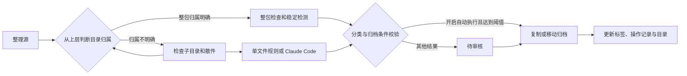

<div align="center">
  
  <h1>FileAtlas</h1>
  <p><a href="README.md">简体中文</a> · <a href="README.en.md">English</a></p>
  <p>让每一份文件，各归其位。</p>
  <p>Windows 智能文件整理 · Claude Code 自动标签 · 多级分类 · 实时目录</p>
  <p>
    
    
    
    
  </p>
</div>

FileAtlas 是一款面向 Windows 11 的文件整理桌面应用。为每个分类设置保存地址，再指定接收文件的整理源。FileAtlas 会优先判断整个文件夹的归属，也能为散件生成分类建议和标签，按配置执行复制、移动或人工审核。

界面采用系统 Acrylic 半透明背景、浅色侧栏、圆角面板和短过渡动画。目录扫描、AI 分类、文件操作和内容预览在后台运行。


**工作台**显示当前整理项、最近动态和本轮进度。图中的 `1/3` 表示本轮已处理 1 项，共 3 项。单个文件和完整交付目录各计一项。截图使用演示数据，散件分类使用了模拟模型响应。 [更新记录](CHANGELOG.md)

## 快速开始

### 使用 Windows 便携版

下载 v0.3.1 安装程序或便携包。便携包解压后运行 `FileAtlas.exe`，保留同目录的 `_internal` 文件夹。源码运行和构建方法见下文。 [Windows 下载与更新说明](https://github.com/AHuaWinliver/FileAtlas/releases/tag/v0.3.1) · [源码标签](https://github.com/AHuaWinliver/FileAtlas/tags)

## 图解整理流程

### 1. 设置多级分类与整包规则


在 **分类与目录** 新建「工程资料 → 试验交付」，为「试验交付」指定独立保存地址，例如 `D:\归档\试验交付`。已有分类目录可以通过 **从现有目录生成分类** 导入。在「分类依据」中添加 `文件夹规则：齿轮箱台架交付 | 电驱试验资料包`，每个名称都按完整目录名匹配。

把下列材料放入整理源后，软件会将「齿轮箱台架交付」归到「试验交付」。包内相对路径随整包保留。采购合同可以按 `扩展名规则：.txt` 自动分流，归属待确认的调试纪要可进入审核。

```text
收件箱/
├── 齿轮箱台架交付/
│   ├── 01_模型/装配.step
│   ├── 02_报告/试验结论.pdf
│   └── 03_图片/台架.png
├── 01_采购合同.txt
└── 02_台架调试纪要.md
```

| 目录情况 | 处理方式 |
| --- | --- |
| 完整目录名命中唯一的文件夹规则 | 把目录作为一个整体。若下层存在另一个显式归属，则继续下钻 |
| 目录与唯一可归档分类同名 | 可按整包处理。如果该分类有扩展名规则，则包内文件类型须符合规则 |
| 目录名明确但缺少规则 | Claude Code 根据目录名、父目录名及有限的浅层相对名称判断。归属清晰且置信度足够时保留整包 |
| 通用名称、混合内容或证据不足 | 继续检查子目录，剩余散件按文件规则和模型判断 |
| 受保护的 CAE 工况 | 包含受保护求解材料或工况标记的目录保留原位 |

在移动模式中，模型判断的整包会先进入待审核。

### 2. 设置整理源并开始扫描


在 **自动化设置** 添加一个或多个整理源，选择 **复制** 或 **移动**。使用模型时，选择本机 `claude.exe`。**文件夹优先**默认开启。首次使用时，可以用默认的复制模式和人工审核检查分类结果。

保存后，点击 **扫描源文件夹** 做一次扫描，或在工作台点击 **启动整理** 持续监控。也可点击 **保存并启动自动整理** 保存设置、开启自动执行并启动监控。**暂停整理** 和 **停止整理** 会在当前项处理完成后生效。暂停后可点击 **继续整理**，停止后再次启动会重新扫描。

### 3. 审核分类、标签和依据


在 **待审核** 选中调试纪要，预览区显示模型的分类依据、标签和内容摘录。核对后，可在底部选定「工程资料 / 试验交付」，点击 **按所选分类整理**，也可点击 **重新分析所选** 再生成建议。

### 4. 在目录树查看整包归档结果


「齿轮箱台架交付」在分类树中显示为一条 **整包** 记录。可双击打开归档目录，或点击 **导出目录 Markdown** 生成目录清单。在 **文件资料库** 可按文件名、路径、分类或标签检索。

### 5. 查看记录并撤销


在 **整理记录** 选中要回退的一项，点击 **撤销所选操作**。FileAtlas 核验内容和路径后执行撤销，表格中的 `undone` 表示撤销完成。**清空日志** 和工作台的 **清空动态** 同步刷新活动视图，历史操作仍可查阅和撤销。

## CAE 工程模板


在 **分类与目录** 创建 CAE 工作空间，再选择 **新建工程项目**。填写项目编号和名称后，可预览阶段目录与 `C001` 基准工况。模板会标出可分类目录和完整保护目录，项目编号不明确的资料会进入审核。 [CAE 工程流程](docs/CAE_WORKFLOW.md)

## 从源码运行

需要 Windows 11 x64、Python 3.12，以及已安装并配置的 [Claude Code](https://code.claude.com/docs/en/overview)。测试和启动空白界面无需模型账号；实际 AI 分类需要可用的 Claude Code 服务配置。

```powershell
python -m venv .venv
.\.venv\Scripts\python.exe -m pip install -r requirements.txt
.\.venv\Scripts\python.exe app.py
```

## Claude Code 与数据流



Claude Code 进程在本机运行，模型位置取决于配置的服务。目录级判断只发送目录名和有限的浅层相对名称。单文件判断使用文件名、路径信息和可选内容摘录。选择云服务时，这些信息会发往该服务。选择兼容的本地服务时，由本地模型处理。

应用继承 Claude Code 的认证与模型配置，也支持在本应用内覆盖模型和服务地址，不修改全局 Claude 设置。分类调用禁用工具、MCP、斜杠命令和 Hooks。AI 返回分类 ID 与标签，实际文件操作由应用执行。

标签、配置和日志保存在 `%LOCALAPPDATA%\FileAtlas`，不修改原文件内容或文件名中的标签。

## 文件保护与当前边界

- 同名文件保留双方；复制后核验 SHA-256，移动模式在校验后移除源文件。
- 整包额外校验相对路径、空子目录和内容。撤销时若发现包内内容变化，会保留归档副本并给出原因。
- 撤销前校验目标；目标已修改、原路径被占用等情形会阻止破坏性操作。
- 支持文本、PDF、DOCX 摘录；图片、扫描 PDF、旧版 Office、音视频与压缩包当前按名称和元数据分类，没有 OCR。
- 文件稳定窗口为至少 3 秒；大于 30MB 的文件仅使用元数据。
- 资料库每次展示最近 1,000 条匹配结果；目录树每个分类展示最多 200 个文件；导出目录包含全部已索引与已归档记录。
- 跨文件系统移动与数据库更新不能组成原子事务。意外退出的未完成记录标记为 `recovery`，需要核对源与目标。
- 当前为早期版本，尚未完成大规模耐久、断电故障注入或长期网络盘测试。

完整说明见 [使用指南](docs/USER_GUIDE.md)。

## 开发与测试

```powershell
# 不需要 Claude 或网络请求
.\.venv\Scripts\python.exe -m unittest discover -s tests -v
.\.venv\Scripts\python.exe scripts/validate_worker.py
.\.venv\Scripts\python.exe scripts/validate_ui.py

# 可选：调用你已配置的真实模型，只处理专用样例
.\.venv\Scripts\python.exe scripts/validate_live.py

# 构建 Windows EXE 并生成发行 ZIP
.\.venv\Scripts\python.exe -m pip install -r requirements-dev.txt
.\.venv\Scripts\python.exe scripts/build.py
```

可使用 `app.py --data-dir <路径>` 指定独立数据目录，使用 `--smoke` 验证启动和截图。

## 仓库结构

```text
FileAtlas/
├── .github/            # Windows CI、打包流程和协作模板
├── assets/             # 图标与界面预览
├── docs/               # 使用指南、调研、验证和发布说明
├── scripts/            # 构建与集成验证脚本
├── tests/              # 核心文件操作测试
├── app.py              # 桌面界面
├── bundles.py          # 整包快照、校验复制和安全撤销所需的文件系统操作
├── core.py             # 分类、索引、文件整理与撤销
├── worker.py           # 后台监控与任务处理
└── FileAtlas.spec      # PyInstaller 构建配置
```

## 文档与参与

- [使用指南](docs/USER_GUIDE.md) · [竞品调研](docs/RESEARCH.md) · [验证记录](docs/VALIDATION.md)
- [上传 GitHub](docs/GITHUB_UPLOAD.md) · [发布说明](docs/RELEASING.md)
- [贡献指南](CONTRIBUTING.md) · [安全与隐私](SECURITY.md) · [更新记录](CHANGELOG.md)

欢迎通过 Issues 提交问题或功能建议，通过 Pull Request 参与改进。提交日志前请删除私人路径、文件内容和服务凭据。

## 许可证

FileAtlas 自有源码使用 [MIT License](LICENSE)。第三方组件保留各自许可证，详见 [THIRD_PARTY_NOTICES.md](THIRD_PARTY_NOTICES.md)。
