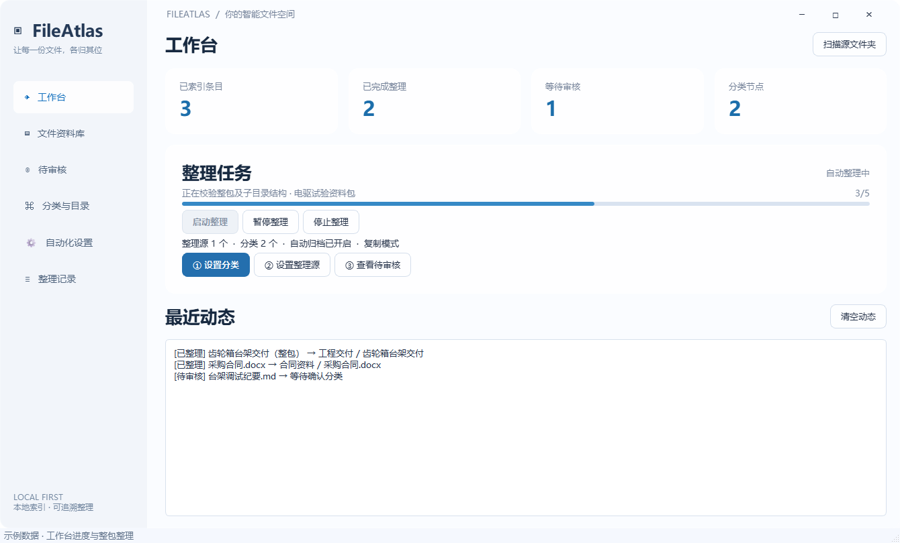

<div align="center">
  
  <h1>FileAtlas</h1>
  <p><a href="README.md">简体中文</a> · <a href="README.en.md">English</a></p>
  <p>让每一份文件，各归其位。</p>
  <p>Windows 智能文件整理 · Claude Code 自动标签 · 多级分类 · 实时目录</p>
  <p>
    
    
    
    
  </p>
</div>

FileAtlas 是一款面向 Windows 11 的文件整理桌面应用。为每个分类设置保存地址，再指定接收文件的整理源。FileAtlas 会优先判断整个文件夹的归属，也能为散件生成分类建议和标签，按配置执行复制、移动或人工审核。

界面采用系统 Acrylic 半透明背景、浅色侧栏、圆角面板和短过渡动画。目录扫描、AI 分类、文件操作和内容预览在后台运行。



## 功能

**v0.3.0 新增文件夹优先整理。** 同一个工程交付目录可以作为一项整理任务，内部模型、图纸、报告和空子目录会一并保留。工作台支持启动、暂停、继续和停止，并显示本轮进度。 [更新记录](CHANGELOG.md)

| 功能 | 说明 |
| --- | --- |
| 多级分类 | 自定义父子分类，每个节点可设置独立保存地址与分类依据 |
| 现有目录导入 | 从现有文件夹结构生成分类，并索引原有文件 |
| 文件夹优先整理 | 从上层识别整包，归属不明确时继续检查子目录。整包在资料库和目录树中各占一条 |
| 自动标签 | 明确规则可直接匹配。Claude Code 可根据文件元数据和可选摘录生成建议 |
| 工作台控制 | 启动、暂停、继续、停止和单次扫描。显示当前阶段与已处理数/总数 |
| 自动归档 | 高置信度结果直接整理，其他结果进入待审核 |
| 文件目录 | 更新逻辑目录树，支持导出完整 Markdown 目录 |
| 整理记录 | 记录源与目标路径、操作状态，支持校验后撤销 |
| 文件检索 | 按文件名、路径、分类及标签搜索 |
| CAE 工程模板 | 预览创建工作空间、项目阶段和基准工况，支持项目编号审核与求解文件保护 |

## 快速开始

### 使用 Windows 便携版

已发布的 Windows 安装程序和便携包可在 GitHub Releases 下载。便携包解压后运行 `FileAtlas.exe`，保留同目录的 `_internal` 文件夹。v0.3.0 源码可从标签获取，运行和构建方法见下文。 [Windows 下载](https://github.com/AHuaWinliver/FileAtlas/releases) · [源码标签](https://github.com/AHuaWinliver/FileAtlas/tags)

1. 在 **分类与目录** 中新建分类，为每个分类设置保存地址和归属依据，也可导入已有目录。
2. 在 **自动化设置** 中添加整理源。需要模型分类时，配置 `claude.exe`，可在这里覆盖模型或服务地址。
3. 在工作台点击 **扫描源文件夹** 进行单次扫描，到 **待审核** 确认分类或手动选择目标。
4. 想持续监控时点击 **启动整理**。需要高置信度结果自动归档时，先在设置中开启 **自动执行**，或直接使用 **保存并启动自动整理**。

初始默认采用复制模式并保留人工审核。关闭窗口后可继续在托盘运行；右键托盘图标可退出。重新启动应用后需要再次启动监控。

### 整包规则示例

整理源中放入以下材料，并把「工程交付」分类的保存地址设为 `D:\归档\工程交付`。

```text
收件箱/
├── 齿轮箱台架交付/
│   ├── 01_模型/装配.step
│   ├── 02_报告/试验结论.pdf
│   └── 03_图片/台架.png
└── 采购合同.pdf
```

在「工程交付」的分类依据中另起一行填写 `文件夹规则：齿轮箱台架交付 | 电驱试验资料包`。规则匹配完整文件夹名，多个别名用 `|` 分隔。归档后目标路径为 `D:\归档\工程交付\齿轮箱台架交付`，内部层级保留，台架交付计为一个整理项。散件「采购合同.pdf」继续按自身规则或模型判断。要按类型分流散件，可在对应分类的依据中填写 `扩展名规则：.pdf .docx`，唯一匹配时直接给出分类与扩展名标签。

| 目录情况 | 处理方式 |
| --- | --- |
| 完整目录名命中唯一的文件夹规则 | 把目录作为一个整体。若下层存在另一个显式归属，则继续下钻 |
| 目录与唯一可归档分类同名 | 可按整包处理。如果该分类有扩展名规则，则包内文件类型须符合规则 |
| 目录名明确但缺少规则 | Claude Code 根据目录名、父目录名及有限的浅层相对名称判断。归属清晰且置信度足够时保留整包 |
| 通用名称、混合内容或证据不足 | 继续检查子目录，剩余散件按文件规则和模型判断 |
| 受保护的 CAE 工况 | 包含受保护求解材料或工况标记的目录保留原位 |

在移动模式中，模型判断的整包进入待审核。文件夹优先默认开启，可在「自动化设置」中关闭。CAE 目录、项目编号和工况细节见 [CAE 工程流程](docs/CAE_WORKFLOW.md)。

### 工作台与记录

- **启动整理**扫描现有内容并持续监控。**扫描源文件夹**执行单次扫描。
- **暂停整理**在当前文件或整包安全处理完后生效，可点击 **继续整理**。**停止整理**结束本轮，重新启动时重新扫描。
- 进度使用 `已处理/本轮总数`。整包计一项，工作台同时显示当前文件夹或处理阶段。
- **清空动态**和**清空日志**同步从新消息开始显示。整理记录仍可查阅和撤销，资料库和待审核页可单独清空预览。

### 从源码运行

需要 Windows 11 x64、Python 3.12，以及已安装并配置的 [Claude Code](https://code.claude.com/docs/en/overview)。测试和启动空白界面无需模型账号；实际 AI 分类需要可用的 Claude Code 服务配置。

```powershell
python -m venv .venv
.\.venv\Scripts\python.exe -m pip install -r requirements.txt
.\.venv\Scripts\python.exe app.py
```

## Claude Code 与数据流


Claude Code 进程在本机运行，模型位置取决于配置的服务。目录级判断只发送目录名和有限的浅层相对名称。单文件判断使用文件名、路径信息和可选内容摘录。选择云服务时，这些信息会发往该服务。选择兼容的本地服务时，由本地模型处理。

应用继承 Claude Code 的认证与模型配置，也支持在本应用内覆盖模型和服务地址，不修改全局 Claude 设置。分类调用禁用工具、MCP、斜杠命令和 Hooks。AI 返回分类 ID 与标签，实际文件操作由应用执行。

标签、配置和日志保存在 `%LOCALAPPDATA%\FileAtlas`，不修改原文件内容或文件名中的标签。

## 文件保护与当前边界

- 同名文件保留双方；复制后核验 SHA-256，移动模式在校验后移除源文件。
- 整包额外校验相对路径、空子目录和内容。撤销时若发现包内内容变化，会保留归档副本并给出原因。
- 撤销前校验目标；目标已修改、原路径被占用等情形会阻止破坏性操作。
- 支持文本、PDF、DOCX 摘录；图片、扫描 PDF、旧版 Office、音视频与压缩包当前按名称和元数据分类，没有 OCR。
- 文件稳定窗口为至少 3 秒；大于 30MB 的文件仅使用元数据。
- 资料库每次展示最近 1,000 条匹配结果；目录树每个分类展示最多 200 个文件；导出目录包含全部已索引与已归档记录。
- 跨文件系统移动与数据库更新不能组成原子事务。意外退出的未完成记录标记为 `recovery`，需要核对源与目标。
- 当前为早期版本，尚未完成大规模耐久、断电故障注入或长期网络盘测试。

完整说明见 [使用指南](docs/USER_GUIDE.md)。

## 开发与测试

```powershell
# 不需要 Claude 或网络请求
.\.venv\Scripts\python.exe -m unittest discover -s tests -v
.\.venv\Scripts\python.exe scripts/validate_worker.py
.\.venv\Scripts\python.exe scripts/validate_ui.py

# 可选：调用你已配置的真实模型，只处理专用样例
.\.venv\Scripts\python.exe scripts/validate_live.py

# 构建 Windows EXE 并生成发行 ZIP
.\.venv\Scripts\python.exe -m pip install -r requirements-dev.txt
.\.venv\Scripts\python.exe scripts/build.py
```

可使用 `app.py --data-dir <路径>` 指定独立数据目录，使用 `--smoke` 验证启动和截图。

## 仓库结构

```text
FileAtlas/
├── .github/            # Windows CI、打包流程和协作模板
├── assets/             # 图标与界面预览
├── docs/               # 使用指南、调研、验证和发布说明
├── scripts/            # 构建与集成验证脚本
├── tests/              # 核心文件操作测试
├── app.py              # 桌面界面
├── bundles.py          # 整包快照、校验复制和安全撤销所需的文件系统操作
├── core.py             # 分类、索引、文件整理与撤销
├── worker.py           # 后台监控与任务处理
└── FileAtlas.spec      # PyInstaller 构建配置
```

## 文档与参与

- [使用指南](docs/USER_GUIDE.md) · [竞品调研](docs/RESEARCH.md) · [验证记录](docs/VALIDATION.md)
- [上传 GitHub](docs/GITHUB_UPLOAD.md) · [发布说明](docs/RELEASING.md)
- [贡献指南](CONTRIBUTING.md) · [安全与隐私](SECURITY.md) · [更新记录](CHANGELOG.md)

欢迎通过 Issues 提交问题或功能建议，通过 Pull Request 参与改进。提交日志前请删除私人路径、文件内容和服务凭据。

## 许可证

FileAtlas 自有源码使用 [MIT License](LICENSE)。第三方组件保留各自许可证，详见 [THIRD_PARTY_NOTICES.md](THIRD_PARTY_NOTICES.md)。
