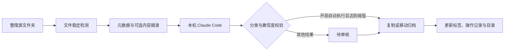

<div align="center">
  
  <h1>FileAtlas</h1>
  <p><a href="README.md">简体中文</a> · <a href="README.en.md">English</a></p>
  <p>让每一份文件，各归其位。</p>
  <p>Windows 智能文件整理 · Claude Code 自动标签 · 多级分类 · 实时目录</p>
  <p>
    
    
    
    
  </p>
</div>

FileAtlas 是一款面向 Windows 11 的本地文件整理桌面应用。设置好分类、保存地址和整理源后，它会在文件变化时调用本机 Claude Code，生成分类建议与标签，并按你的设置执行复制或移动。

界面采用系统 Acrylic 半透明背景、浅色侧栏、圆角面板和短过渡动画。目录扫描、AI 分类、文件操作和内容预览在后台运行。


## 功能

**0.2.0 新增 CAE 工程模板**：预览创建工作空间，按项目编号建立阶段目录及基准工况，支持独立保存地址、项目编号审核和求解文件保护。详见 [CAE 工程流程](docs/CAE_WORKFLOW.md) 与 [快速使用说明](docs/QUICK_START.md)。

| 功能 | 说明 |
| --- | --- |
| 多级分类 | 自定义父子分类，每个节点可设置独立保存地址与分类依据 |
| 现有目录导入 | 从现有文件夹结构生成分类，并索引原有文件 |
| 自动标签 | Claude Code 根据文件名、路径及可选内容摘录生成标签 |
| 实时监控 | 递归监控多个源文件夹，文件稳定后进入分析队列 |
| 自动归档 | 高置信度结果直接整理，其他结果进入待审核 |
| 文件目录 | 更新逻辑目录树，支持导出完整 Markdown 目录 |
| 整理记录 | 记录源与目标路径、操作状态，支持校验后撤销 |
| 文件检索 | 按文件名、路径、分类及标签搜索 |

## 快速开始

### 使用 Windows 便携版

从 [Releases](https://github.com/AHuaWinliver/FileAtlas/releases) 下载 `FileAtlas-0.2.0-win64.zip`，解压后运行 `FileAtlas.exe`。请保留同目录的 `_internal` 文件夹。

1. 在 **分类与目录** 中新建分类，设置保存地址和分类依据，或导入已有目录。
2. 在 **自动化设置** 中选择默认整理源，确认 `claude.exe` 路径并保存。
3. 点击 **扫描源文件夹**，到 **待审核** 检查分类建议。
4. 确认效果后，选择复制或移动模式，开启 **自动执行**，再点击 **启动自动监控**。

初始默认采用复制模式并保留人工审核。关闭窗口后可继续在托盘运行；右键托盘图标可退出。重新启动应用后需要再次启动监控。

### 从源码运行

需要 Windows 11 x64、Python 3.12，以及已安装并配置的 [Claude Code](https://code.claude.com/docs/en/overview)。测试和启动空白界面无需模型账号；实际 AI 分类需要可用的 Claude Code 服务配置。

```powershell
python -m venv .venv
.\.venv\Scripts\python.exe -m pip install -r requirements.txt
.\.venv\Scripts\python.exe app.py
```

## Claude Code 与数据流



Claude Code 进程在本机运行，模型的运行位置取决于它配置的服务。使用云服务时，文件名、路径和启用后的内容摘录会发送到该服务；使用兼容本地服务时由本地模型处理。可以关闭内容摘录。

应用继承 Claude Code 的认证与模型配置，也支持在本应用内覆盖模型和服务地址，不修改全局 Claude 设置。分类调用禁用工具、MCP、斜杠命令和 Hooks。AI 返回分类 ID 与标签，实际文件操作由应用执行。

标签、配置和日志保存在 `%LOCALAPPDATA%\FileAtlas`，不修改原文件内容或文件名中的标签。

## 文件保护与当前边界

- 同名文件保留双方；复制后核验 SHA-256，移动模式在校验后移除源文件。
- 撤销前校验目标；目标已修改、原路径被占用等情形会阻止破坏性操作。
- 支持文本、PDF、DOCX 摘录；图片、扫描 PDF、旧版 Office、音视频与压缩包当前按名称和元数据分类，没有 OCR。
- 文件稳定窗口为至少 3 秒；大于 30MB 的文件仅使用元数据。
- 资料库每次展示最近 1,000 条匹配结果；目录树每个分类展示最多 200 个文件；导出目录包含全部已索引与已归档记录。
- 跨文件系统移动与数据库更新不能组成原子事务。意外退出的未完成记录标记为 `recovery`，需要核对源与目标。
- 当前为早期版本，尚未完成大规模耐久、断电故障注入或长期网络盘测试。

完整说明见 [使用指南](docs/USER_GUIDE.md)。

## 开发与测试

```powershell
# 不需要 Claude 或网络请求
.\.venv\Scripts\python.exe -m unittest discover -s tests -v
.\.venv\Scripts\python.exe scripts/validate_worker.py
.\.venv\Scripts\python.exe scripts/validate_ui.py

# 可选：调用你已配置的真实模型，只处理专用样例
.\.venv\Scripts\python.exe scripts/validate_live.py

# 构建 Windows EXE 并生成发行 ZIP
.\.venv\Scripts\python.exe -m pip install -r requirements-dev.txt
.\.venv\Scripts\python.exe scripts/build.py
```

可使用 `app.py --data-dir <路径>` 指定独立数据目录，使用 `--smoke` 验证启动和截图。

## 仓库结构

```text
FileAtlas/
├── .github/            # Windows CI、打包流程和协作模板
├── assets/             # 图标与界面预览
├── docs/               # 使用指南、调研、验证和发布说明
├── scripts/            # 构建与集成验证脚本
├── tests/              # 核心文件操作测试
├── app.py              # 桌面界面
├── core.py             # 分类、索引、文件整理与撤销
├── worker.py           # 后台监控与任务处理
└── FileAtlas.spec      # PyInstaller 构建配置
```

## 文档与参与

- [使用指南](docs/USER_GUIDE.md) · [竞品调研](docs/RESEARCH.md) · [验证记录](docs/VALIDATION.md)
- [上传 GitHub](docs/GITHUB_UPLOAD.md) · [发布说明](docs/RELEASING.md)
- [贡献指南](CONTRIBUTING.md) · [安全与隐私](SECURITY.md) · [更新记录](CHANGELOG.md)

欢迎通过 Issues 提交问题或功能建议，通过 Pull Request 参与改进。提交日志前请删除私人路径、文件内容和服务凭据。

## 许可证

FileAtlas 自有源码使用 [MIT License](LICENSE)。第三方组件保留各自许可证，详见 [THIRD_PARTY_NOTICES.md](THIRD_PARTY_NOTICES.md)。
